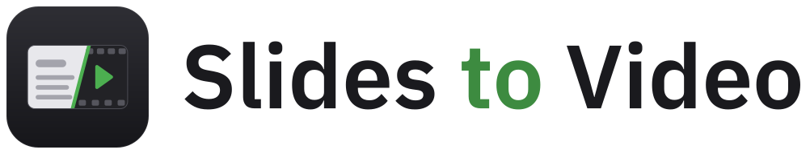

<p align="center">
  <picture>
    <source media="(prefers-color-scheme: dark)" srcset="assets/wordmark-on-dark.svg">
    
  </picture>
</p>
<br>

A Mac app that turns a slide deck into a narrated video. Open a PDF, write the narration for each slide, give it a few seconds of your voice, and it reads your script in your voice over the slides.

## Features

- **Voice cloning** from a short voice sample, with Qwen3-TTS (10 languages) or Chatterbox (English) running on your Mac
- **Remote GPUs** over SSH, on any server with uv and CUDA
- **Cloud voices** through ElevenLabs, Cartesia, or any HTTP endpoint you configure
- **Video export** to MP4 at up to 4K, with optional SRT subtitles
- **Per-slide editing**: change one slide's text and regenerate only that slide
- **Play All** previews the whole talk with pauses and click sounds between slides
- **Ambient pauses** filled with the voice model's own background noise
- **Speed control** and inline `[pause]` markers

## Install

Download `SlidesToVideo-<version>.dmg` from the [latest release](https://github.com/joshuaswanson/slides-to-video/releases/latest), open it, and drag **Slides to Video** to Applications.

The app is not notarized by Apple, so macOS blocks it on first launch. Open it once, then go to **System Settings > Privacy & Security** and click **Open Anyway**.

To generate voices on your Mac or a remote server, install [uv](https://docs.astral.sh/uv/). The cloud APIs need only an API key.

## Requirements

- macOS 15 or later, Apple Silicon recommended
- [uv](https://docs.astral.sh/uv/), which the app uses to install and run the TTS engines
- Xcode 16 or later to build the app

## Build and Run

```bash
cd macos
swift run SlidesToVideo
```

To build the app bundle and DMG (universal, ad-hoc signed) into `macos/dist/`:

```bash
macos/Packaging/build_dmg.sh
```

Choose **New from PDF** and pick your slides. The app creates `script.md` next to the PDF with one section per page. In Settings, pick a TTS engine and a voice sample, then click **Load Engine**. The first load installs the engine's Python environment, which takes a few minutes.

Shortcuts: **←/→** switch slides, **⌘G** regenerates the current slide, **⌘↩** plays the whole talk, **⌘E** exports the video, and **⌘S** saves the script.

Speed on an M1 Max, after the model has loaded:

| Engine     | Time per second of speech |
| ---------- | ------------------------- |
| Chatterbox | about 4 s                 |
| Qwen3-TTS  | about 9 s                 |

## Remote GPU

Qwen3-TTS and Chatterbox can also run on any machine you can reach over SSH. In Settings, set **Runs On** to **Remote server**, enter the host (`user@host` or an alias from `~/.ssh/config`), and click **Load Engine**. The server needs [uv](https://docs.astral.sh/uv/) and a CUDA GPU. The app uses your SSH keys and config, so jump hosts work as they do in Terminal.

The app runs one `ssh` process that starts the worker from the release matching the app version, as described under TTS Worker. **CUDA devices** limits which GPUs the worker sees, and **Remote command** replaces the default command, for example to run a checkout on the server. A dropped connection stays down until you click **Load Engine** again. The app never reconnects on its own.

## Cloud APIs

Pick ElevenLabs, Cartesia, or Custom HTTP endpoint as the TTS engine, paste your API key in Settings, and click **Connect**. Keys are stored in the macOS Keychain. The app clones your voice sample once per provider and remembers the voice ID. When you change the voice sample, it creates the new clone and then deletes the old one from your account. Before **Generate All Audio** sends anything to a paid API, it shows how many characters it will send and asks you to confirm.

The custom endpoint posts a JSON body you write, with `{{text}}`, `{{language}}`, and `{{voice_id}}` placeholders, and accepts an audio file, raw 16-bit PCM, or JSON with a base64 audio field in response.

## Projects

A project is a folder:

```
my-talk/
  talk.pdf               # slides
  script.md              # narration, one section per slide
  voice_sample.m4a       # voice to clone
  slides-to-video.json   # engine, language, pause, speed, click, export settings
  .cache/                # generated audio
```

`script.md` is plain markdown. Slides are separated by lines containing only `---`, and each starts with a `## Slide N` heading, where `N` is the PDF page number:

```markdown
## Slide 1 - Title

This is the narration for the first slide.

---

## Slide 2 - Introduction

Paragraphs and line breaks are kept in the file and joined for narration.

Use [pause] for a 0.5 second pause, or [pause 1.5] for a custom duration.
```

You can edit `script.md` in any editor. The app reloads it when you switch back. Each slide occupies `[pause][narration][pause]`, and the click sound is placed so the slide changes between the key press and the release.

Audio is cached per slide in `.cache/audio_clips/`. A clip is reused while the slide's narration, the voice sample, the engine, and the language are unchanged.

## TTS Worker

The app generates speech through `slides-to-video-worker`, a small Python process in this repository that it talks to over stdin and stdout. Run from a checkout, the app uses the checkout's code. A standalone build downloads the source archive of the release tag matching its version, then runs the worker with `uv run --frozen`, so it gets exactly the dependency versions in that release's `uv.lock`. Remote servers run the same steps over SSH and cache them in `~/.cache/slides-to-video`.

Chatterbox runs on Python 3.11, because its dependencies pin packages without Python 3.12 wheels.

## Development

```bash
uv run pytest                 # Python worker tests
cd macos && swift test        # app tests
```

The Python tests use a fake TTS engine. To run the app's end-to-end test with a real engine on this Mac:

```bash
cd macos
S2V_INTEGRATION=1 S2V_VOICE=/path/to/voice.m4a S2V_ENGINE=chatterbox swift test --filter IntegrationTests
```

Add `S2V_SOURCE=release` to run the worker from the GitHub release, the way a downloaded app does. To export an existing project as a test, run `S2V_EXPORT_PROJECT=/path/to/project swift test --filter ProjectExportTests`.

## Project Structure

```
macos/
  Sources/SlidesToVideo/        # app entry point
  Sources/SlidesToVideoKit/
    Model/                      # script format, clip cache, narration track, video export
    Speech/                     # worker process, SSH and cloud backends, engine controller
    Views/                      # SwiftUI interface
  Tests/
  Packaging/                    # app icon and DMG build script
src/slides_to_video/
  worker.py                     # slides-to-video-worker
  speech.py                     # narration with [pause] markers, ambient loop
  tts_engines.py                # Qwen3 and Chatterbox
tests/
assets/                         # README images
examples/
  example_script.md
```

## Support

If you find this useful, [buy me a coffee](https://buymeacoffee.com/swanson).


